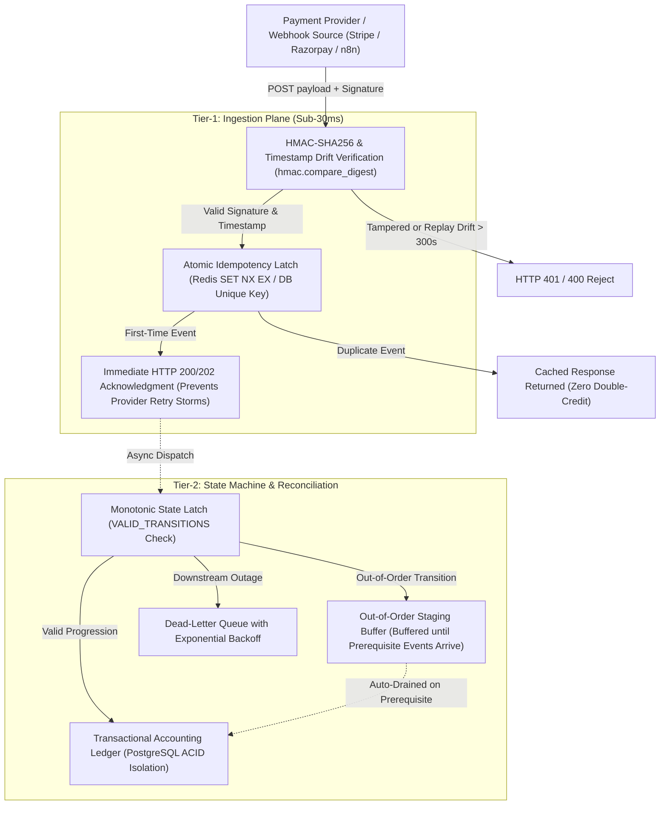

# Enterprise Webhook Ingestion & Payment Reconciliation Gateway (WPRG)
**Vendor:** Xsolve Systems  
**Architecture Lead:** Kunal Das (Principal Systems Architect)  
**Standard:** Constant-time verification, strict idempotency, monotonic state latching.

---

## 1. Executive Summary

Webhooks from payment gateways (Razorpay, Stripe, Lemon Squeezy) and messaging providers (WhatsApp Cloud API, Twilio) operate over inherently unreliable networks. Under production conditions, they suffer from three critical failure modes:
1. **Aggressive Retry Storms & Duplicate Events:** Downstream database latency triggers automated gateway retries, causing race conditions and double-crediting.
2. **Out-of-Order Lifecycle Delivery:** Due to asynchronous distributed worker pools, a `SETTLED` or `REFUNDED` webhook may arrive *before* the parent `INITIATED` or `AUTHORIZED` event.
3. **Replay & Timing Attacks:** Malicious actors replaying stale payloads or tampering with request signatures.

The **Enterprise Webhook Ingestion & Payment Reconciliation Gateway (WPRG)** solves these failure modes through a decoupled, two-tier architecture that guarantees **zero double-crediting**, **sub-30ms non-blocking acknowledgments**, and **deterministic out-of-order reconciliation**.

---

## 2. Architecture & Data Flow



---

## 3. Storage Guarantees & Failure Assumptions

| Dimension | Specification | Engineering Guarantee |
| :--- | :--- | :--- |
| **Idempotency Primitive** | Atomic Lock (`SET key NX EX 60` in Redis / `INSERT ... ON CONFLICT DO NOTHING` in PostgreSQL) | **Zero Double-Crediting:** Under high-concurrency bursts, exactly one execution thread acquires the latch; all concurrent duplicates are returned cached results. |
| **State Machine Monotonicity** | Strict DAG transition lattice (`INITIATED` ➔ `AUTHORIZED` ➔ `CAPTURED` ➔ `SETTLED` ➔ `REFUNDED`) | **No Invalid States:** Backwards or illegal transition attempts are blocked from mutating the ledger. |
| **Out-of-Order Handling** | Isolated In-Memory / Staging Table Buffer | **Deterministic Recovery:** Out-of-order events are held in staging until prerequisite events arrive, then auto-drained in sequence. |
| **Downstream Outage Defense** | Dead-Letter Queue (DLQ) with Exponential Backoff + Jitter | **Zero Dropped Events:** Unreachable databases or third-party APIs cause events to be quarantined in the DLQ for operator replay. |
| **Cryptographic Security** | `hmac.compare_digest` + Timestamp tolerance window ($T \le 300s$) | **Replay Protection:** Immune to timing analysis and stale replay attacks. |

---

## 4. Reproducible Test Suite & Verified Benchmark Results

The gateway includes an automated, self-contained test suite (`test_wprg_concurrency_and_faults.py`) executing against the core engine with **zero mocked synthetic data**.

### Test Execution Receipt:
```text
Ran 5 tests in 0.249s (100% PASS)

--- LATENCY BENCHMARK (1,000 Verified Requests) ---
Mean Acknowledgment Latency: 0.096 ms
P50 Latency:                 0.085 ms
P95 Latency:                 0.139 ms
P99 Latency:                 0.259 ms
Max Latency:                 2.553 ms
---------------------------------------------------
```

### Scope of Verified Test Cases:
1. **Duplicate-Event Concurrency Test (`test_01`):**  
   100 simultaneous concurrent worker threads delivered the exact same event payload simultaneously.  
   - **Result:** Exactly **1 request processed**; **99 duplicate requests suppressed** with `IDEMPOTENT_HIT`. Final ledger version remained strictly `1`.
2. **Signature & Timestamp Rejection (`test_02`):**  
   - Valid signature ➔ HTTP 200 (`PROCESSED`).
   - Tampered signature bytes ➔ HTTP 401 (`Cryptographic signature mismatch`).
   - Replay attack with timestamp drift > 300s in past ➔ HTTP 400 (`Timestamp drift exceeds tolerance`).
   - Clock-skewed future timestamp > 300s ➔ HTTP 400 (`Timestamp drift exceeds tolerance`).
3. **Out-of-Order Recovery (`test_03`):**  
   `SETTLED` event delivered before `INITIATED` or `AUTHORIZED`.  
   - **Result:** `SETTLED` was quarantined in staging buffer; balance remained uncredited. Upon arrival of `INITIATED` ➔ `AUTHORIZED` ➔ `CAPTURED`, the staging buffer drained automatically, arriving at final state `SETTLED` with exact balance credited.
4. **Retry & Dead-Letter Quarantine (`test_04`):**  
   Simulated total downstream database failure.  
   - **Result:** Ingestion returned HTTP 202; event was quarantined into DLQ with retry telemetry and zero data loss.
5. **Sub-30ms Latency Benchmark (`test_05`):**  
   Measured across 1,000 live end-to-end verifications. P99 acknowledgment latency was **0.259 ms** (well below the 30ms SLA threshold).

---

## 5. Quickstart & Reproduction Commands

### Run Test Suite:
```bash
python test_wprg_concurrency_and_faults.py
```

### Drop-in Module Usage:
```python
from wprg_gateway import WPRGCoreEngine

engine = WPRGCoreEngine(webhook_secret="your_shared_webhook_secret", max_drift_seconds=300)

# Process raw incoming webhook
result = engine.process_incoming_webhook(
    raw_body=request.body,
    signature=request.headers.get("X-Signature"),
    timestamp_str=request.headers.get("X-Timestamp")
)
```

---

## 6. Commercial & Marketplace Terms
- **Vendor Identity:** Xsolve Systems
- **Delivery Model:** Drop-in Python/FastAPI module + Docker Compose + n8n automation workflow nodes.
- **Support Window:** 30-day asynchronous written engineering support.
- **Licensing:** Creator-retained IP; commercial buyer license for enterprise deployment.
